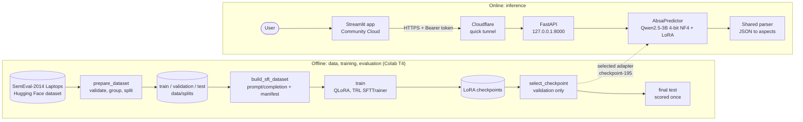
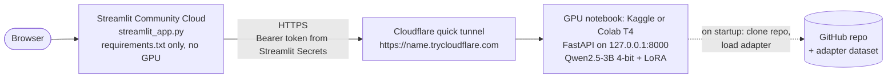
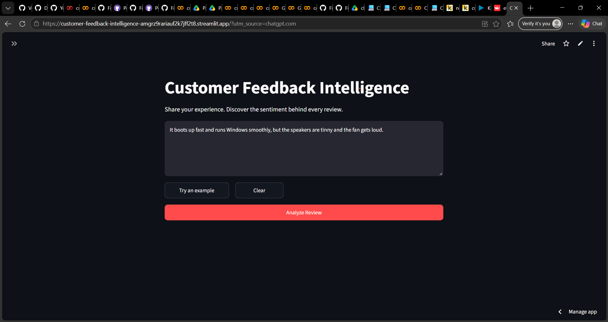
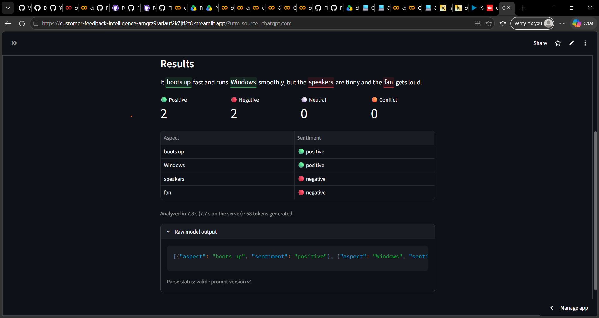

# Customer Feedback Intelligence

**Aspect-based sentiment analysis with a QLoRA fine-tuned Qwen2.5-3B-Instruct, served from a GPU inference API to a Streamlit app.**

A single review often praises one part of a product and criticizes another. This project fine-tunes a small open LLM to read a review, extract every **aspect** it mentions and classify the **sentiment** toward each one, returning structured JSON:

> "I charge it at night and skip taking the cord with me because of the good battery life."
> → `[{"aspect": "cord", "sentiment": "neutral"}, {"aspect": "battery life", "sentiment": "positive"}]`

**Live app:** [Open the Streamlit app](https://customer-feedback-intelligence-amgrz9rariauf2k7jff2t8.streamlit.app/)
The app needs the GPU backend (a Kaggle or Colab notebook) to be running. When it is offline, the sidebar shows *Remote inference API unavailable* and analysis is paused; see [Deployment](#deployment).

## Objectives

- Fine-tune **Qwen2.5-3B-Instruct** with **QLoRA** to perform aspect extraction and sentiment classification **jointly**, in one generation.
- Beat a **zero-shot baseline** of the same model with the same prompt, on a held-out test split that is never used for training or model selection.
- Keep training and inference feasible on a single 16 GB **T4** GPU through 4-bit quantization and LoRA adapters.
- Ship the model behind a **secured inference API** and a **Streamlit** interface, with a reproducible, tested pipeline.

## Results

Held-out **test split** (222 reviews, 360 gold aspects), same prompt, parser and metrics for both models:

| Metric | Zero-shot Qwen2.5-3B-Instruct | Fine-tuned (QLoRA, `checkpoint-195`) |
|---|---:|---:|
| Aspect precision | n/a | 86.40% |
| Aspect recall | n/a | 84.72% |
| **Aspect F1** | 36.18% | **85.55%** |
| **Aspect + sentiment F1** | 30.92% | **73.77%** |
| Sentiment accuracy (matched aspects) | n/a | 86.23% |
| Sentiment macro F1 (4 labels) | n/a | 79.95% |
| Valid JSON responses | n/a | 222 / 222 (0 invalid) |
| Invented aspects (not in the review) | n/a | 5 |

The checkpoint was chosen on the **validation** split; the test split was scored once, afterwards.

> **Provenance.** These numbers come from the final evaluation run on Colab (`outputs/eval/final_test_summary.json` and `baseline_test_summary.json`). Evaluation outputs and model weights are kept on Google Drive and are not committed, so the scores cannot be recomputed from this repository alone. *n/a* means the value was not recorded in this README, not that it is zero. See [Evaluation](#evaluation) for how to reproduce them.

## Features

- **Joint aspect extraction + sentiment classification** into four labels: `positive`, `negative`, `neutral`, `conflict`.
- **Strict, non-repairing output parser**: invalid JSON, unknown labels and aspects that are not in the review are flagged, never silently fixed or dropped.
- **Leakage-free data pipeline**: review-level stratified splits, integrity checks and SHA-256 checksums on every generated file.
- **Validation-only model selection** and a single, guarded test evaluation (`--final-test`).
- **Streamlit app**: highlighted review, per-aspect table, sentiment counts, warnings and the raw model output when the answer is not valid.
- **GPU inference API** (FastAPI) with bearer-token authentication, warm-up timing and clear error codes.
- **No silent CPU fallback**: if the remote API is unavailable the app says so instead of quietly running a slow local model.
- **Tests**: data processing, parsing, metrics, training configuration, inference, the API, the API client and the Streamlit app are unit-tested with `pytest`. The notebooks are checked for structure, secrets and valid commands, but are not executed by the test suite.

## Engineering highlights

- **Test suite:** 280+ `pytest` tests across 13 test files. They use canned model outputs, so the suite runs on a CPU without downloading the model, while still exercising the real prompt, parser and metrics.
- **Data-leakage checks:** splits are disjoint by review ID and by normalized text (case and whitespace variants included), and the SFT build stops if any check fails. Every command that could read the test split refuses unless `--final-test` is passed; tests confirm that training, checkpoint selection and the benchmark never read it.
- **Reproducibility:** fixed seeds (42), SHA-256 checksums of the splits, generated files and system prompt, verified before training, and a `run_info.json` per run with the config, library versions and git commit.
- **Strict evaluation:** the parser never repairs model output. Invalid JSON, unknown labels and invented aspects all count against the model.
- **Token-protected API:** the service refuses to start without a token of at least 32 characters, compares tokens in constant time (`hmac.compare_digest`), requires the token on every endpoint, listens on `127.0.0.1` only and disables the interactive docs. The client refuses plain `http://` for remote hosts, and its error messages never include the token.
- **Explicit failure handling:** if the GPU API is unavailable, the app shows the reason and never silently falls back to slow CPU inference.

## System architecture



Training, the baseline, evaluation, the API and the app all import the **same prompt** (`src/data/prompts.py`), **predictor** (`src/modeling/inference.py`) and **parser** (`src/evaluation/parsing.py`), so the deployed model is served exactly as it was evaluated.

## Technology stack

| Area | Tools |
|---|---|
| Language | Python 3.11+ (developed and tested on 3.11) |
| Base model | [Qwen/Qwen2.5-3B-Instruct](https://huggingface.co/Qwen/Qwen2.5-3B-Instruct) |
| Fine-tuning | QLoRA: PyTorch, Hugging Face Transformers, PEFT, TRL (`SFTTrainer`), bitsandbytes, Accelerate |
| Data | Hugging Face Datasets, pandas, PyYAML, scikit-learn (stratified splits) |
| Evaluation | scikit-learn (per-label and macro F1) and custom span-matching metrics |
| Serving | FastAPI, Uvicorn, Pydantic |
| Front end | Streamlit, deployed on Streamlit Community Cloud |
| GPU hosting | Kaggle or Google Colab notebooks (T4) |
| Networking | Cloudflare quick tunnel (`cloudflared`) |
| Testing | pytest, Streamlit `AppTest`, FastAPI `TestClient` |

## Dataset

**Source:** [`tomaarsen/setfit-absa-semeval-laptops`](https://huggingface.co/datasets/tomaarsen/setfit-absa-semeval-laptops), a Hugging Face version of the **SemEval-2014 Task 4 laptop reviews**. Each row is one aspect annotation (`text`, `span`, `label`, `ordinal`).

| | Count |
|---|---:|
| Labeled annotation rows (source `train` split) | 2,358 |
| Duplicate rows removed | 16 |
| **Labeled reviews / aspects after cleaning** | **1,479 / 2,342** |
| Unlabeled reviews (source `test` split, no sentiment labels; never used for training or scoring) | 422 |

The labeled reviews are split **70 / 15 / 15 at the review level** (seed 42), stratified by each review's rarest label so `conflict` appears in every split:

| Split | Reviews | Aspects | Positive | Negative | Neutral | Conflict |
|---|---:|---:|---:|---:|---:|---:|
| Train | 1,035 | 1,623 | 656 | 620 | 315 | 32 |
| Validation | 222 | 359 | 158 | 122 | 72 | 7 |
| Test | 222 | 360 | 167 | 115 | 72 | 6 |

The splits are committed in `data/splits/` and regenerated with `python -m src.data.prepare_dataset` (settings in `configs/data.yaml`). The pipeline:

1. validates rows (missing values, unknown labels, spans not found in the text, duplicates, conflicting labels) and drops and counts bad rows rather than repairing them;
2. normalizes whitespace (three training reviews appeared twice, once with a leading non-breaking space);
3. groups annotations into one record per review with character offsets;
4. treats the source `test` split as unlabeled, because all of its sentiment labels are empty.

**Leakage prevention** (`src/data/build_sft_dataset.py` stops on any failure): no review ID or normalized text is shared between splits; every reference answer must round-trip through the evaluation parser; and a manifest records SHA-256 checksums of the splits, the generated files and the system prompt.

## Model and fine-tuning

The task is framed as **instruction tuning**: the system prompt defines the four labels and the output rules, the user message is the review, and the assistant answers with a JSON array only. Examples use TRL's prompt/completion format, so the loss covers **only the answer**.

| Setting | Value (`configs/train.yaml`) |
|---|---|
| Quantization | 4-bit **NF4**, double quantization, float16 compute (T4 has no bf16) |
| LoRA | r = 16, alpha = 32, dropout = 0.05, no bias |
| LoRA target modules | `q_proj`, `k_proj`, `v_proj`, `o_proj`, `gate_proj`, `up_proj`, `down_proj` |
| Epochs / learning rate | 3 / 2e-4, cosine schedule, 3% warmup |
| Batch size | 4 per device × 4 gradient accumulation = 16 |
| Optimizer | `paged_adamw_8bit`, fp16, gradient checkpointing, SDPA attention |
| Max sequence length | 1,024 tokens (checked against the real chat template before training) |
| Seed | 42 |

`src/modeling/train.py` verifies the SFT manifest against the splits, loads **only** train and validation, checks token lengths and the installed TRL version, then trains and writes a checkpoint per epoch plus `run_info.json` (config, data checksums, training log, library versions, git commit).

**Checkpoint selection** (`src/evaluation/select_checkpoint.py`) generates validation predictions for every checkpoint and picks the highest aspect + sentiment F1, with ties going to aspect F1 and then the earlier checkpoint. The selected adapter is **`checkpoint-195`**.

**Inference** (`src/modeling/inference.py`): greedy decoding, up to 256 new tokens, `repetition_penalty` explicitly set to 1.0 (Qwen's default of 1.05 also affects greedy search), left padding, and only the newly generated tokens are decoded.

## Evaluation

Predictions are parsed with `src/evaluation/parsing.py`, which never repairs an answer:

| Problem | Handling |
|---|---|
| Not valid JSON / extra text | `invalid_json`, no predictions (all gold aspects of the review are missed) |
| Unknown label (e.g. `"Positive"`) | kept with `label_valid=False`, always counted wrong |
| Aspect not in the review | kept with `invented=True`, counted as a false positive |

Metrics (`src/evaluation/metrics.py`): within a review, the k-th prediction of a term is paired with the k-th gold occurrence of that term (case- and whitespace-insensitive).

| Metric | Definition |
|---|---|
| Aspect P / R / F1 | Matched terms vs. all predicted and all gold aspects |
| Aspect + sentiment F1 | Matched terms whose sentiment is also correct |
| Sentiment accuracy / macro F1 | On matched aspects, over the four labels (also reported without `conflict`) |
| Diagnostics | Valid / malformed / invalid-JSON responses, invented aspects, invalid labels |

The test split is refused by every command unless `--final-test` is passed. As a sanity check, scoring the reference answers gives 1.0 on every metric (`tests/test_metrics.py`).

## Inference API

`src/serving/api.py` wraps the same `AbsaPredictor` in a FastAPI service for a CUDA GPU. It loads the model once in a background thread, runs one warm-up review, and serves requests one at a time.

Both endpoints require `Authorization: Bearer <token>`:

| Endpoint | Description |
|---|---|
| `GET /health` | `status` (`loading`, `ready` or `error`), GPU name, precision, prompt version and warm-up timings |
| `POST /predict` | Body `{"text": "<review>"}`. Returns the raw `response`, parse `status`, `errors`, `aspects` (each with `aspect`, `sentiment`, `start`, `end`, `label_valid`, `invented`), `generated_tokens`, `truncated` and `server_seconds` |

Errors: `401` for a missing or invalid token, `422` for invalid input, `503` while the model is loading, `500` if inference fails; each has a readable `detail`.

```bash
curl -s -X POST "$CFI_API_URL/predict" \
  -H "Authorization: Bearer $CFI_API_TOKEN" \
  -H "Content-Type: application/json" \
  -d '{"text": "The screen is bright, but the battery life is disappointing."}'
```

**Security:** the service refuses to start without a `CFI_API_TOKEN` of at least 32 characters, compares tokens in constant time, binds to `127.0.0.1` only (the tunnel is the only public entry point) and disables the interactive docs. The app refuses plain `http://` for non-local hosts, so the token never travels unencrypted.

## Installation and reproduction

```bash
git clone https://github.com/eliechahoud7/customer-feedback-intelligence.git
cd customer-feedback-intelligence
python -m venv .venv
source .venv/bin/activate            # Windows: .venv\Scripts\activate
```

| Goal | Install |
|---|---|
| Streamlit app against the remote API | `pip install -r requirements.txt` |
| Training, the API, local inference, tests | Install the PyTorch build for your platform first, then `pip install -r requirements-ml.txt` |

**Run the tests:** `python -m pytest`

**Reproduce the pipeline** (a CUDA GPU is required for QLoRA; the notebook [`notebooks/colab_train_eval.ipynb`](notebooks/colab_train_eval.ipynb) runs the same steps on a Colab T4):

```bash
python -m src.data.prepare_dataset                                   # optional: splits are committed
python -m src.data.build_sft_dataset                                 # SFT files + checksum manifest
python -m src.modeling.train --check-data                            # data and token-length checks only
python -m src.modeling.train                                         # QLoRA training
python -m src.evaluation.select_checkpoint --run-dir outputs/qwen2.5-3b-absa-qlora
# Once, after selection: the selected checkpoint (and, without --adapter, the zero-shot baseline) on test
python -m src.modeling.inference --split test --final-test \
    --adapter outputs/qwen2.5-3b-absa-qlora/checkpoint-195 --output outputs/eval/final_test.jsonl
python -m src.evaluation.metrics --split test --final-test \
    --responses outputs/eval/final_test.jsonl > outputs/eval/final_test_summary.json
```

**Run the app locally:**

```bash
# Remote GPU inference (default): the URL is printed by the inference notebook
export CFI_API_URL="https://<name>.trycloudflare.com"
export CFI_API_TOKEN="<your token>"
streamlit run streamlit_app.py
# Windows PowerShell: $env:CFI_API_URL = "https://<name>.trycloudflare.com"; $env:CFI_API_TOKEN = "<your token>"
```

Alternatively copy `.streamlit/secrets.toml.example` to `.streamlit/secrets.toml` (git-ignored). To run the model on your own machine instead, set `CFI_INFERENCE_MODE=local` and place the adapter files (`adapter_config.json`, `adapter_model.safetensors`) in `models/checkpoint-195/` or point `CFI_ADAPTER_PATH` at them. On CPU this is slow (about 30 to 40 s per short review measured on an Intel i7-1165G7 with 16 GB RAM).

**Latency benchmark** against a running API: `python -m src.serving.benchmark --requests 6` reports the first request and later requests separately, as client and server time.

## Deployment



- **Front end:** Streamlit Community Cloud installs only `requirements.txt` (no PyTorch). `CFI_API_URL` and `CFI_API_TOKEN` are set under *App settings > Secrets*.
- **GPU backend:** [`notebooks/kaggle_inference_api.ipynb`](notebooks/kaggle_inference_api.ipynb) (Kaggle, adapter from a private Kaggle dataset) or [`notebooks/colab_inference_api.ipynb`](notebooks/colab_inference_api.ipynb) (Colab, adapter from Google Drive). Each notebook installs the project, starts the API on the GPU, opens the tunnel, prints the public URL and checks that requests with the token succeed and requests without it get `401`.
- **Secrets:** the API token lives only in the notebook platform's secret store and in Streamlit Secrets; it is never printed or committed. `models/`, `*.safetensors`, `.env*` and `.streamlit/secrets.toml` are git-ignored.
- **Operating constraint:** the backend runs only while the notebook session is alive, and a quick tunnel gets a **new URL on every start**, so `CFI_API_URL` must be updated after each restart.

## Screenshots

### Project Dashboard



### Prediction Results




## Limitations

- **Single domain.** The model was trained and evaluated only on laptop reviews (the system prompt says so too). It accepts any text, but accuracy on other products or services has not been measured.
- **Sentence-level training data.** SemEval reviews are mostly single sentences (median 83 characters), so long multi-paragraph reviews are out of distribution. The app limits input to 1,500 characters.
- **No aspect-free examples.** Every labeled review has at least one aspect, so the model never saw an empty answer during training and may invent aspects for texts without any (5 invented aspects on the test split).
- **Rare `conflict` class.** Only 6 test aspects are `conflict`, so its F1 is noisy; macro F1 is also reported without it.
- **Explicit aspects only.** Implicit aspects ("it dies after two hours" meaning battery) are not annotated in the dataset and are not extracted.
- **Ephemeral GPU backend.** Free notebook sessions stop when idle or after a time limit, and the quick-tunnel URL changes on every restart, so the live app is not always available.
- **Not measured yet:** GPU latency through the tunnel, and the baseline's sentiment-level metrics.

## Future improvements

- Move the API to an always-on GPU host or a **named Cloudflare tunnel** for a stable URL.
- Add **aspect-free and out-of-domain** examples (for example SemEval restaurants) to reduce invented aspects and test generalization.
- Report **confidence intervals** (bootstrap) and per-label results, especially for `conflict`.
- **Merge the LoRA adapter** and benchmark faster serving (batched requests, prompt-prefix caching, vLLM).
- Publish a **model card** and the evaluation artifacts alongside the adapter.

## Project structure

```
customer-feedback-intelligence/
├── configs/              # data.yaml (dataset, split), train.yaml (QLoRA hyperparameters)
├── data/splits/          # committed train / validation / test splits (JSONL)
├── notebooks/            # Colab training + evaluation; Colab and Kaggle inference API
├── src/
│   ├── data/             # dataset preparation, SFT examples, shared prompt
│   ├── modeling/         # QLoRA training, AbsaPredictor inference
│   ├── evaluation/       # parser, metrics, checkpoint selection
│   ├── serving/          # FastAPI inference API, latency/validation benchmark
│   └── app/              # app logic (service.py), remote API client (remote.py)
├── tests/                # pytest suite
├── streamlit_app.py      # Streamlit front end
├── requirements.txt      # app only (installed by Streamlit Community Cloud)
└── requirements-ml.txt   # training, API, local inference, tests
```
